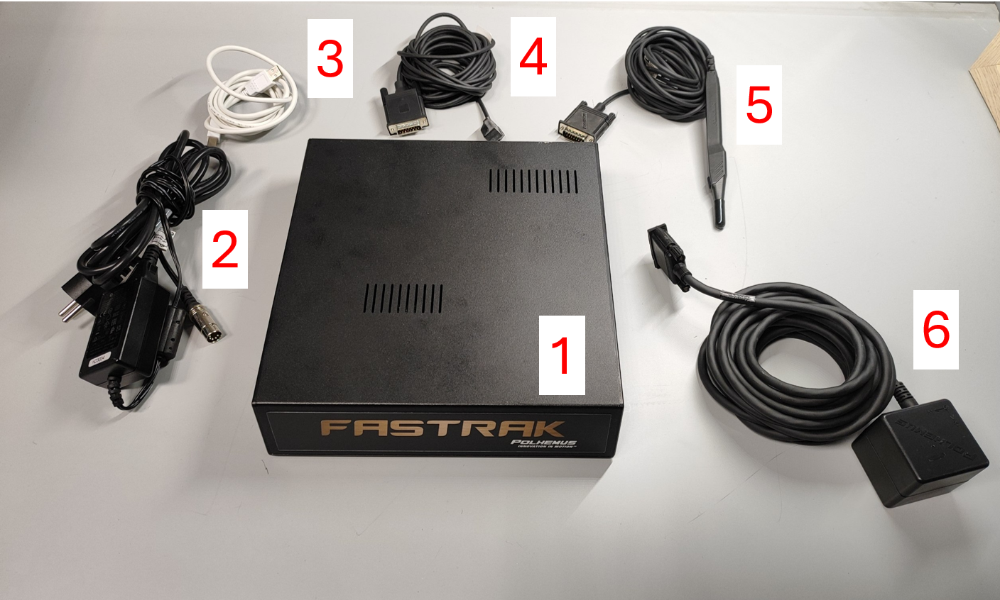
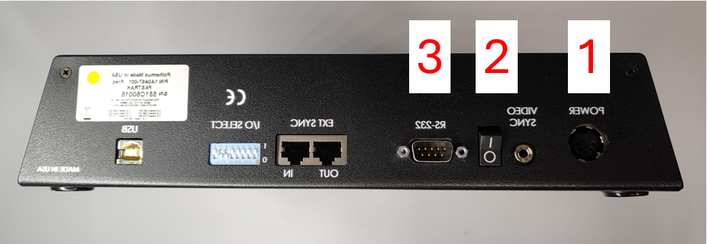
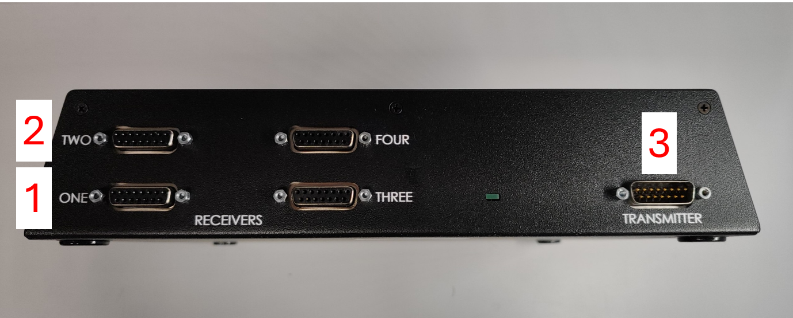
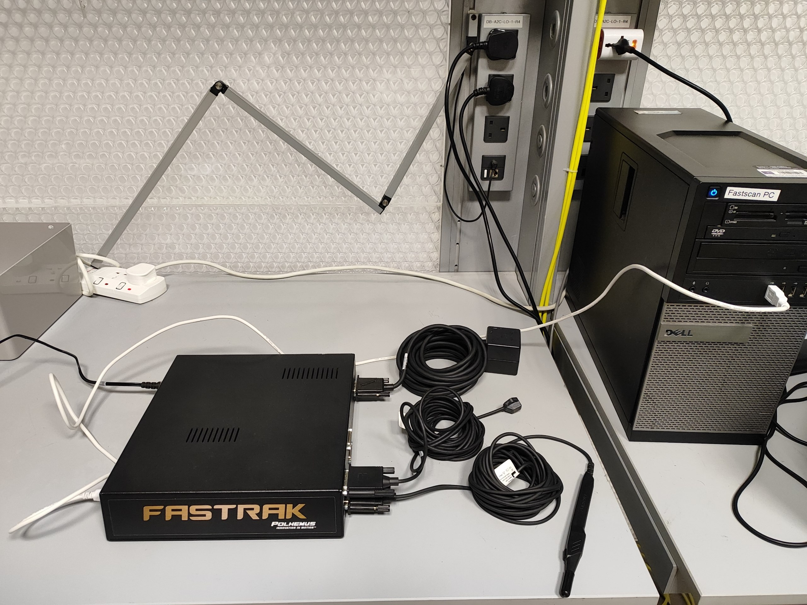
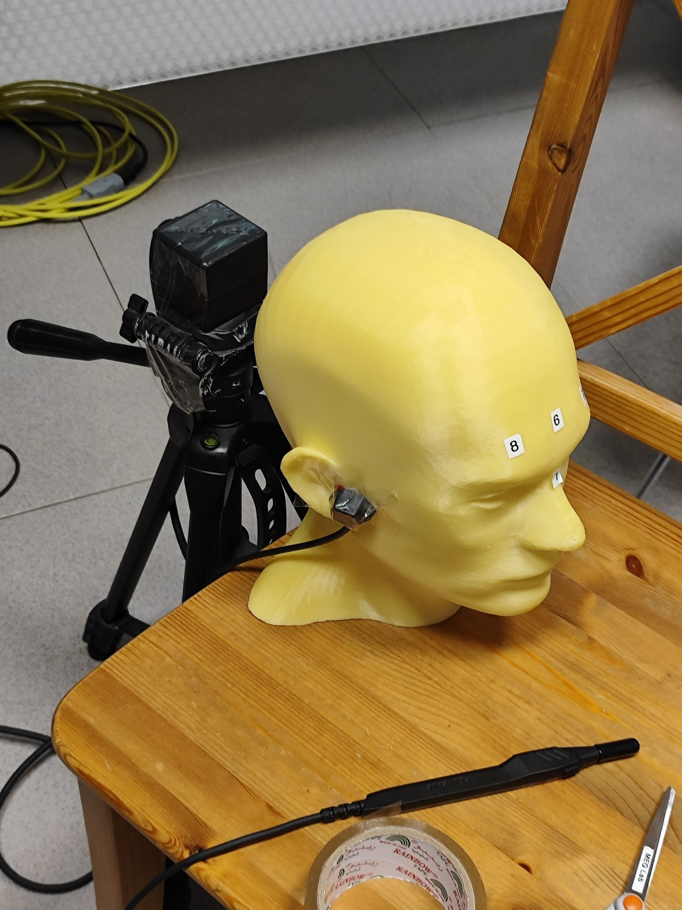
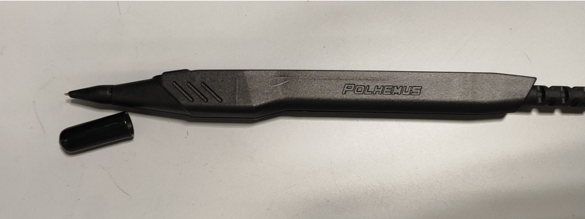
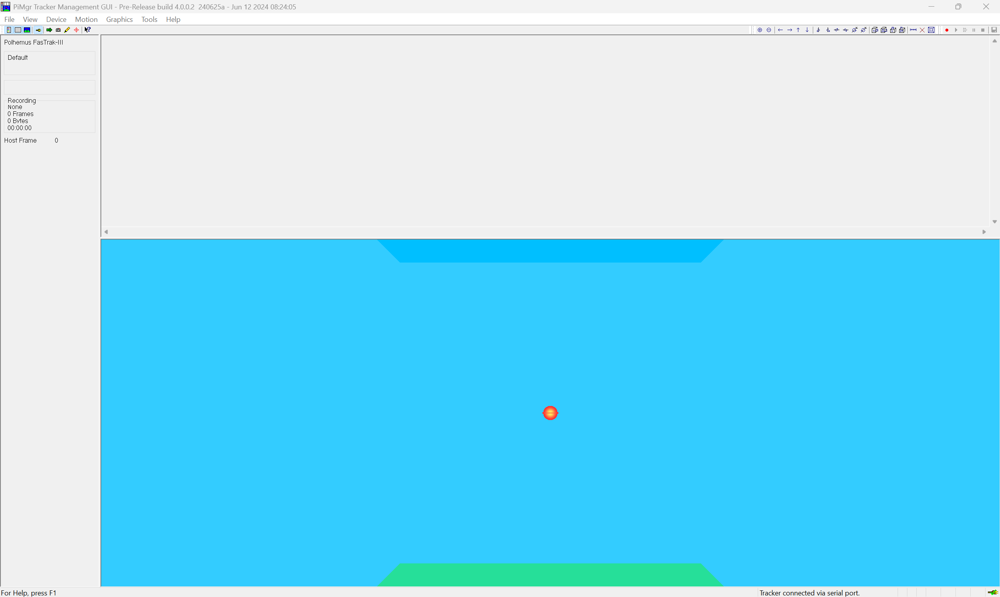
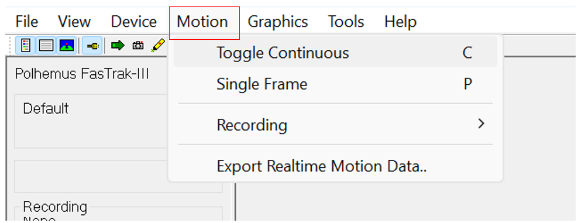
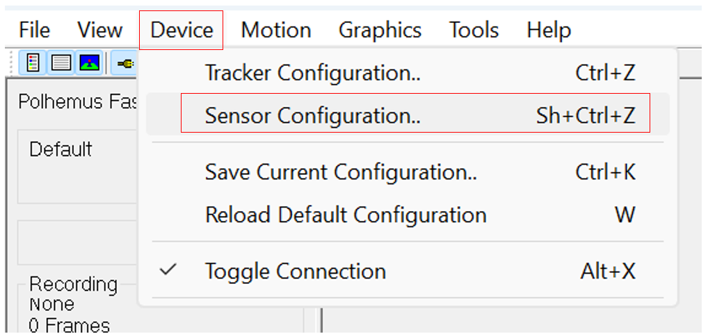
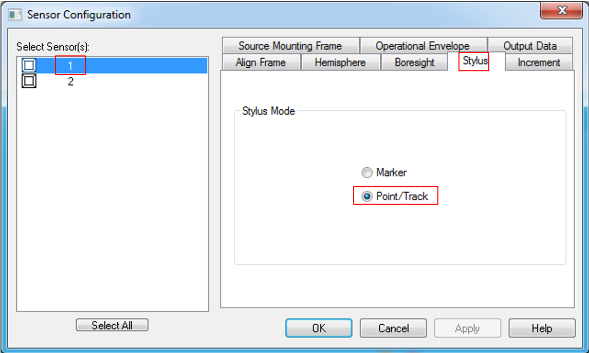

# Polhemus FASTRAK: Head Digitization Guide

The **Polhemus FASTRAK** is an electromagnetic tracking and 3D digitizing system. It measures a sensor's position (**X, Y, Z**) and orientation relative to a transmitter. For head digitization, a stylus records points on the head surface. Together, these points form a **3D point cloud** representing the shape of the head.

This guide covers hardware setup, data collection with **PiMgr**, and data visualization in **MATLAB**.

## Table of Contents

1. [Hardware System Configuration](#1-hardware-system-configuration)
2. [Data Collection with PiMgr Software](#2-data-collection-with-pimgr-software)
3. [Data Visualization with MATLAB](#3-data-visualization-with-matlab)

## 1. Hardware System Configuration

FASTRAK uses a transmitter to generate an electromagnetic field and receivers to measure position and orientation within that field. The **System Electronics Unit (SEU)** processes these measurements and communicates with a computer. The system supports up to **four sensors**, including a digitizing stylus. Further information is available on the [Polhemus FASTRAK product page](https://polhemus.com/all-trackers/fastrak).

For detailed setup instructions, operating procedures, and technical specifications, refer to the [FASTRAK User Manual](manuals/FASTRAK_Manual.pdf).

### 1.1. System Components

  

  <em><strong>Figure 1: Complete FASTRAK System.</strong> 
  1: System Electronics Unit; 2: Charger (power supply); 3: RS-232 to USB-A cable; 
  4: Receiver; 5: Stylus; 6: Transmitter.</em>

### 1.2. Power and Computer Connections

With the unit switched **OFF**, connect the supplied power adapter to the power connector **(1)** and to a mains outlet. Connect the RS-232 end of the RS-232 to USB-A cable to the communication port **(3)** and the USB-A end to the computer.

The **On/Off switch (2)** powers the unit. Leave it **OFF** until the stylus, receiver, and transmitter connections described below are complete.

  

  <em><strong>Figure 2: Power and Communication Panel.</strong> 
  1: Power connector; 2: On/Off switch; 3: RS-232 cable connection.</em>

### 1.3. Stylus, Receiver, and Transmitter Connections

Once the power and computer connections are in place, connect the components on the opposite side of the unit. Connect the **stylus (1)**, **receiver (2)**, and **transmitter (3)** to the corresponding connectors shown in Figure 3.

  

  <em><strong>Figure 3: Stylus, Receiver, and Transmitter Connections.</strong> 
  1: Stylus connector; 2: Receiver connector; 3: Transmitter connector.</em>

After all cables are connected, turn the unit **ON** using the power switch shown in Figure 2.

> [!NOTE]
> The **green status LED** on the sensor connector panel illuminates when the unit is powered. It blinks during initialization and becomes steady once the system is ready for operation.

  

  <em><strong>Figure 4: Fully Connected FASTRAK System.</strong></em>

### 1.4. Positioning and Handling

> [!WARNING]
> **Before collecting head-surface points:**
>
> 1. **Minimize magnetic interference.** Keep the transmitter and tracking area away from magnetic or metallic objects, which can distort the measurements. Place the transmitter close to the head on a stable, preferably nonmetallic support. If using a camera stand, keep its metal parts away from the transmitter and tracking area. Position the setup toward the middle of the room, away from metal furniture, walls, and floors where practical.
> 2. **Fix the receiver securely to the head.** The mounting location can vary, but the receiver must not move relative to the head during acquisition. A suitable head or neck band may be used only if it maintains this rigid attachment; a loose neck band is unsuitable.
> 3. **Remove the stylus cap before collecting data.** Handle the exposed tip carefully and use gentle contact when moving it over the head surface. Replace the protective cap when finished.

  

  <em><strong>Figure 5: Suggested Configuration for Head Phantom Digitization.</strong></em>

  

  <em><strong>Figure 6: Removable Protective Cap of the Stylus.</strong></em>

## 2. Data Collection with PiMgr Software

A **PiMgr prerelease version** is available that supports connecting to FASTRAK at **9600 baud**. Installation information and the installer are available from the [Polhemus PiMgr prerelease page](https://ftp.polhemus1.com/hidden/Software/PiMgr/Prerelease/).

This section introduces basic data collection in **single-point** and **continuous** modes using PiMgr.

### 2.1. Data Collection in Continuous Mode

Open PiMgr. Figure 7 shows the main software window.

  

  <em><strong>Figure 7: PiMgr Main Window.</strong></em>

Toggle **Continuous Mode** using the control shown in Figure 8.

  

  <em><strong>Figure 8: Toggling Continuous Mode in PiMgr.</strong></em>

To use the **button on the stylus** to start and stop data collection, follow the configuration steps shown in Figures 9 and 10.

#### Step 1

  

  <em><strong>Figure 9: Stylus-Button Configuration — Step 1.</strong></em>

#### Step 2

  

  <em><strong>Figure 10: Stylus-Button Configuration — Step 2.</strong></em>

### 2.2. Data Collection in Single-Point Mode

*Instructions to be added.*

## 3. Data Visualization with MATLAB

*Instructions to be added.*
