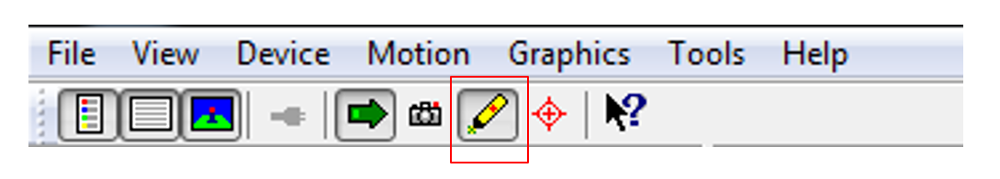
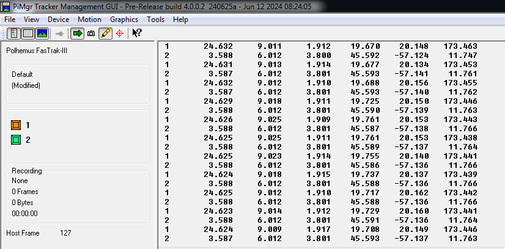
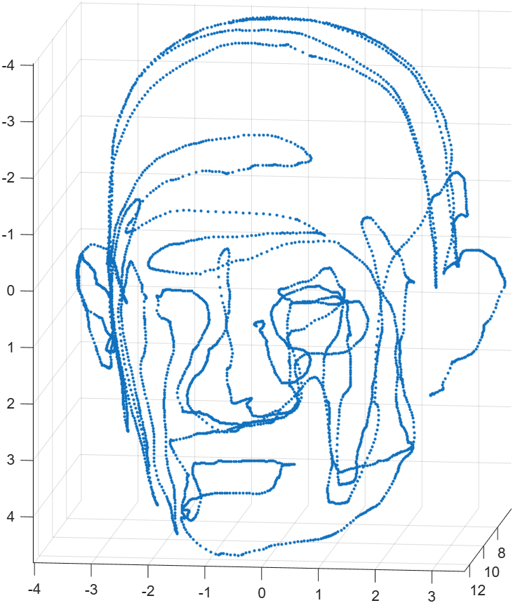
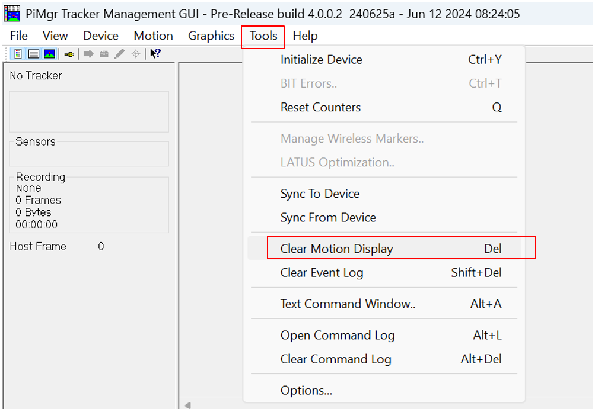

# Polhemus FASTRAK: Head Digitization Guide

The **Polhemus FASTRAK** is an electromagnetic tracking and 3D digitizing system. It measures a sensor's position (**X, Y, Z**) and orientation relative to a transmitter. For head digitization, a stylus records points on the head surface. Together, these points form a **3D point cloud** representing the shape of the head.

This guide covers hardware setup, data collection with **PiMgr**, and data visualization in **MATLAB**.

## Table of Contents

1. [Hardware System Configuration](#1-hardware-system-configuration)
2. [Data Collection with PiMgr Software](#2-data-collection-with-pimgr-software)
3. [Data Visualization with MATLAB](#3-data-visualization-with-matlab)

## 1. Hardware System Configuration

FASTRAK uses a transmitter to generate an electromagnetic field and receivers to measure position and orientation within that field. The **System Electronics Unit (SEU)** processes these measurements and communicates with a computer. The system supports up to **four sensors**, including a digitizing stylus. Further information is available on the [Polhemus FASTRAK product page](https://polhemus.com/all-trackers/fastrak).

For detailed setup instructions, operating procedures, and technical specifications, refer to the [FASTRAK User Manual](manuals/FASTRAK_Manual.pdf).

### 1.1. System Components

<p align="center">
  
</p>
<p align="center">
  <em><strong>Figure 1: Complete FASTRAK System.</strong><br>
  1: System Electronics Unit; 2: Charger (power supply); 3: USB-A cable;<br>
  4: Receiver; 5: Stylus; 6: Transmitter.</em>
</p>

### 1.2. Power and Computer Connections

With the unit switched **OFF**, connect the supplied power adapter to the power connector **(1)** and to a mains outlet. Connect the RS-232 end of the RS-232 to USB-A cable to the communication port **(3)** and the USB-A end to the computer.

The **On/Off switch (2)** powers the unit. Leave it **OFF** until the stylus, receiver, and transmitter connections described below are complete.

<p align="center">
  
</p>
<p align="center">
  <em><strong>Figure 2: Power and Communication Panel.</strong><br>
  1: Power connector; 2: On/Off switch; 3: USB-A cable connection.</em>
</p>

### 1.3. Stylus, Receiver, and Transmitter Connections

Once the power and computer connections are in place, connect the components on the opposite side of the unit. Connect the **stylus (1)**, **receiver (2)**, and **transmitter (3)** to the corresponding connectors shown in Figure 3.

<p align="center">
  
</p>
<p align="center">
  <em><strong>Figure 3: Stylus, Receiver, and Transmitter Connections.</strong><br>
  1: Stylus connector; 2: Receiver connector; 3: Transmitter connector.</em>
</p>

After all cables are connected, turn the unit **ON** using the power switch shown in Figure 2.

> [!NOTE]
> The **green status LED** on the sensor connector panel illuminates when the unit is powered. It blinks during initialization and becomes steady once the system is ready for operation.

<p align="center">
  
</p>
<p align="center">
  <em><strong>Figure 4: Fully Connected FASTRAK System.</strong></em>
</p>

### 1.4. Positioning and Handling

> [!WARNING]
> **Before collecting head-surface points:**
>
> 1. **Minimize magnetic interference.** Keep the transmitter and tracking area away from magnetic or metallic objects, which can distort the measurements. Place the transmitter close to the head on a stable, preferably nonmetallic support. If using a camera stand, keep its metal parts away from the transmitter and tracking area. Position the setup toward the middle of the room, away from metal furniture, walls, and floors where practical.
> 2. **Fix the receiver securely to the head.** The mounting location can vary, but the receiver must not move relative to the head during acquisition. A suitable head or neck band may be used only if it maintains this rigid attachment; a loose neck band is unsuitable.
> 3. **Remove the stylus cap before collecting data.** Handle the exposed tip carefully and use gentle contact when moving it over the head surface. Replace the protective cap when finished.

<p align="center">
  
</p>
<p align="center">
  <em><strong>Figure 5: Suggested Configuration for Head Phantom Digitization.</strong></em>
</p>

<p align="center">
  
</p>
<p align="center">
  <em><strong>Figure 6: Removable Protective Cap of the Stylus.</strong></em>
</p>

## 2. Data Collection with PiMgr Software

A **PiMgr prerelease version** is available that supports connecting to FASTRAK at **9600 baud**. Installation information and the installer are available from the [Polhemus PiMgr prerelease page](https://ftp.polhemus1.com/hidden/Software/PiMgr/Prerelease/).

This section introduces basic data collection in **single-point** and **continuous** modes using PiMgr.

Open PiMgr. Figure 7 shows the main software window.

<p align="center">
  
</p>
<p align="center">
  <em><strong>Figure 7: PiMgr Main Window.</strong></em>
</p>


### 2.1. Configure the Stylus

To control data collection using the **button on the stylus**, follow the configuration steps shown in Figures 8-10.


#### Step 1

<p align="center">
  
</p>
<p align="center">
  <em><strong>Figure 8: Stylus-Button Configuration — Step 1.</strong></em>
</p>

#### Step 2: 

Select **Stylus**, then configure the following settings:

- **Selected Sensor(s):** `1`
- **Stylus Mode:** `Point/Track`

Click **OK** to apply the settings.

<p align="center">
  
</p>
<p align="center">
  <em><strong>Figure 9: Step 2 — Configuring the Stylus.</strong></em>
</p>

#### Step 3: Enable Stylus Point Mode

Toggle **Stylus Point Mode** by clicking the **pencil icon**, as shown in Figure 10.

<p align="center">
  
</p>
<p align="center">
  <em><strong>Figure 10: Step 3 — Enabling Stylus Point Mode.</strong></em>
</p>

With these settings applied we can use the button on the stylus for data collection in continous and single modes.


### 2.2. Data Collection

PiMgr supports **continuous** and **single-point** data collection.

Select **Continuous Mode** using the control shown in Figure 11. After configuring the stylus button as described below, pressing it once starts continuous data collection, and pressing it again pauses collection.

Alternatively, select **Single Frame** instead of Continuous Mode to collect individual points. In this mode, each press of the stylus button records a single point.

<p align="center">
  
</p>
<p align="center">
  <em><strong>Figure 11: Selecting the Data Collection Mode in PiMgr — Continuous Mode Shown.</strong></em>
</p>


#### Understanding the Collected Data

The collected data appear in the PiMgr display as shown below.

<p align="center">
  
</p>
<p align="center">
  <em><strong>Figure 12: Collected Data in Continuous Mode.</strong></em>
</p>

Each row contains one measurement from a sensor. For the output format shown here, the seven columns are:

| Column | Quantity | Description |
| --- | --- | --- |
| 1 | Sensor ID | Identifies the sensor: `1` is the stylus and `2` is the head-mounted receiver in this setup. |
| 2 | X | Position along the X-axis. |
| 3 | Y | Position along the Y-axis. |
| 4 | Z | Position along the Z-axis. |
| 5 | Azimuth | Orientation angle corresponding to yaw, in degrees. |
| 6 | Elevation | Orientation angle corresponding to pitch, in degrees. |
| 7 | Roll | Orientation angle corresponding to roll, in degrees. |

The X, Y, and Z coordinates are reported in the configured tracking coordinate system, normally relative to the transmitter. Position values are in **inches by default**, or **centimeters** if metric output has been selected.

Rows with sensor ID `1` describe the stylus, while rows with sensor ID `2` describe the head-mounted receiver. To visualize the digitized head surface, extract the stylus coordinates from columns **2–4** of the rows labeled `1`.

## 3. Data Visualization with MATLAB

### 3.1. Export the Data from PiMgr

1. Right-click inside the PiMgr data display.
2. Choose **Select All**, then **Copy**.
3. Paste the numerical data into a plain-text editor.
4. Save the file as **`data.txt`**.

Save only the numerical measurement rows, excluding any status messages or other text.

### 3.2. Plot the Head-Surface Points

Place `data.txt` and the MATLAB script in the same directory, and set that directory as MATLAB's **Current Folder**.

Run the following script:

```matlab
data = readmatrix("data.txt");
points = data(data(:,1)==1, 2:4);

scatter3(points(:,1), points(:,2), points(:,3), '.')
axis equal; grid on
set(gca, 'ZDir', 'reverse')
```

The script selects the rows belonging to **sensor 1**, extracts their **X, Y, and Z coordinates**, and displays them as a 3D point cloud.

`axis equal` keeps the same scale along all three axes. The final line reverses the displayed Z-axis direction without changing the recorded coordinates.

This basic visualization plots the stylus positions directly; it does not use sensor 2 to compensate for head movement.


### 3.3. Example Result

Figure 13 shows a trial data collection using a head phantom. Collecting more points, particularly in sparsely sampled regions, can improve the surface coverage and level of detail in the resulting point cloud.

<p align="center">
  
</p>
<p align="center">
  <em><strong>Figure 13: Head Phantom Point Cloud from Trial Data Collection.</strong></em>
</p>

### 3.4. Clearing the Motion Display

After completing data collection, or before starting a new acquisition, clear the motion display by selecting **Tools → Clear Motion Display**.

<p align="center">
  
</p>
<p align="center">
  <em><strong>Figure 14: Clearing the Motion Display in PiMgr.</strong></em>
</p>
