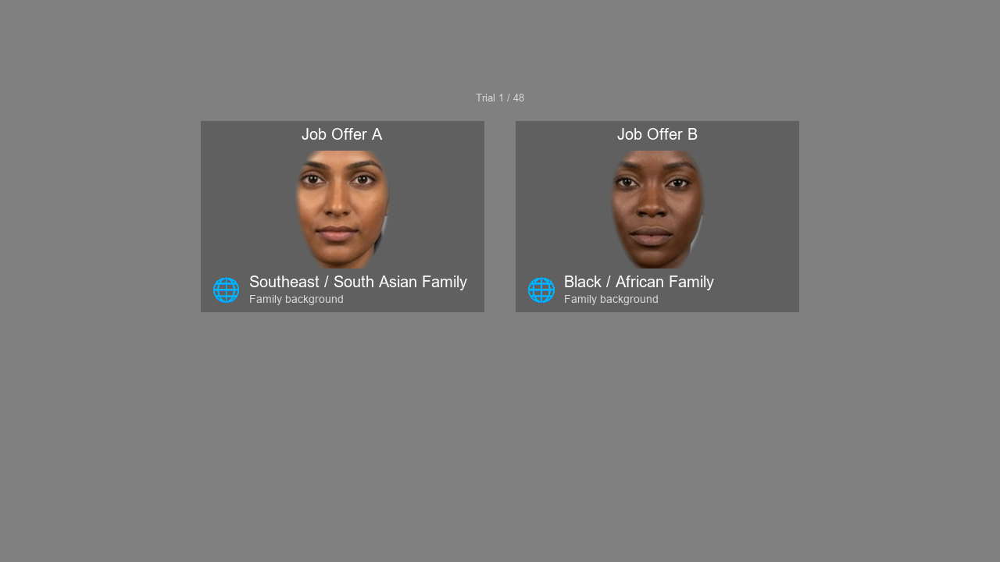
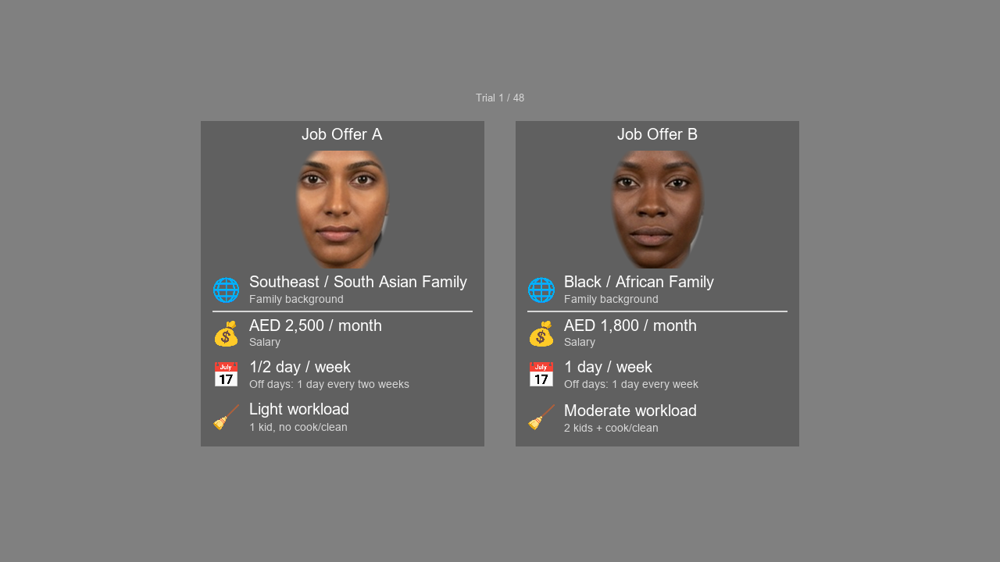
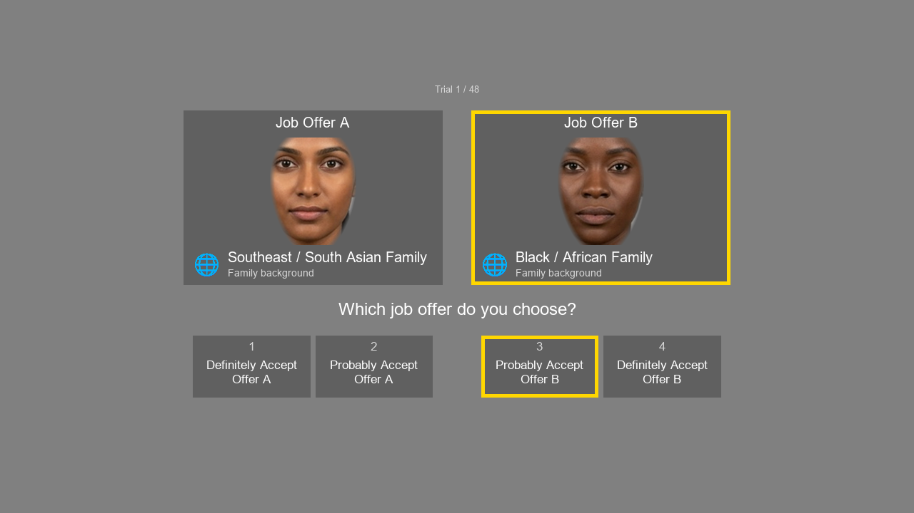

-----------------------------------------
fMRI - Navigating the Job Market (NJM)
-----------------------------------------

Psychtoolbox task for the study *Evaluating Competing Job Offers: Behavioral and Neural Correlates of
Employment Decision-Making Among Household Employees in the UAE* (PI: J. A. Frimpong). It was built from
``experiments/FMRI/template-experiment`` and follows the protocol draft of 11-12-26.

On every trial the participant sees two job offers from two employer families, Offer A on the left and
Offer B on the right, and chooses one on a four-point scale.

Trial structure
^^^^^^^^^^^^^^^

.. list-table::
   :header-rows: 1
   :widths: 20 50 30

   * - Step
     - Screen
     - Time
   * - Fixation
     - cross
     - 1.0 to 4.5 s (jittered)
   * - Phase 1
     - employer photos and family background
     - 4.0 s
   * - Gap
     - cross
     - 1 to 3 s (jittered)
   * - Phase 2
     - full offers: background, salary, off days, workload
     - 5.0 s
   * - Gap
     - cross
     - 1 to 3 s (jittered)
   * - Phase 3
     - the question and four answer options
     - up to 3.0 s
   * - ITI
     - cross
     - 3 to 7 s (jittered)

   Phase 1: the two employers.

   Phase 2: the full offers.

   Phase 3: the decision, here after button 3 was pressed.

Phase 3 ends at the button press, and the chosen option is framed for 0.2 s. The buttons are pressed with
the right hand: 1 (index finger) = Definitely Accept Offer A,
2 (middle) = Probably Accept Offer A, 3 (ring) = Probably Accept Offer B, 4 (little finger) = Definitely
Accept Offer B.

Session
^^^^^^^

A session is 4 runs of 12 trials (48 trials). Each run lasts 292 s (4.87 min): program 198 volumes at the
placeholder TR of 1.5 s. The task prints the number of volumes for the TR set in the parameter file.
Each run has 10 trade-off trials, 1 trial with identical job terms but different employer origins, and
1 catch trial (one offer better on everything).

The 48 pairs of offers are the same for every participant. They use 96 different job profiles out of the
108 possible ones, with every level of every attribute equally often. The following is randomised for each
participant, seeded by the subject ID, saved once in the participant's data folder and re-used by all four
runs:

- which trials go in which run, and their order (the catch trial is never first or last);
- left/right position: half of the trials of every run are swapped;
- which face shows each employer origin (every face equally often);
- the order of the jitter values.

Running the task
^^^^^^^^^^^^^^^^

Run these in MATLAB from the experiment folder.

.. list-table::
   :header-rows: 1
   :widths: 28 30 42

   * - What
     - Command
     - Notes
   * - Practice (mock scanner)
     - ``practice``
     - 6 trials that are not part of the 48; saved as ``task-njmpractice``
   * - Scanner run
     - ``main``
     - a dialog asks for subject, session and run (1 to 4); one call per run
   * - Payment
     - ``njm_payout('0201', '01')``
     - scanner lottery, plus the online lottery if its choices are given; drawn once
   * - Think-aloud playback
     - ``njm_playback('0201', '01')``
     - replays the participant's trials with her choices; arrow keys
   * - Check after any change
     - ``njm_selftest``
     - whole session with a simulated participant (about 3 minutes), then checks the output
   * - Look at the screens
     - ``njm_preview_screens``
     - saves pictures of every screen to ``screens/``
   * - Check the randomisation
     - ``njm_check_design``
     - no window needed

Settings are at the top of ``main.m`` (``debugConfig``), as in the lab template.

.. list-table::
   :header-rows: 1
   :widths: 30 35 35

   * - Setting
     - Scanner
     - Laptop
   * - ``useVPixx``
     - 1
     - 0
   * - ``displayMode``
     - 1
     - 2
   * - ``fullscreen``
     - 1
     - 1 (0 for a window)
   * - ``manualTrigger``
     - 0
     - 1 (press ``t``)
   * - ``buttonbox``
     - 1
     - 0 (keys ``1`` to ``4``)
   * - ``eyetracking``
     - 1 once the EyeLink is set up
     - 0
   * - ``sendMarkers``
     - 1 if a separate physiology recorder needs event codes
     - 0

During a run, ``ESC`` stops it and the data are still saved. On the instruction pages ``SPACE`` goes to
the next page and ``B`` goes back.

On Windows, Psychtoolbox 3.0.22 needs its licence library and GStreamer on the path before ``Screen``
loads. Psychtoolbox's ``PsychStartup`` does this when MATLAB starts. If ``Screen`` reports "Invalid
MEX-file ... module could not be found", that step is missing.

Output
^^^^^^

Each run writes into ``data/exp/sub-<id>/ses-<id>/``:

- ``..._task-njm_run-0N_events.tsv`` and ``.json``: BIDS events, one row per phase and per button press,
  with onsets measured from the first scanner trigger and all trial attributes on every row;
- ``..._task-njm_run-0N.mat``: everything (design, responses, the planned and measured time of every
  screen, settings);
- ``..._eyetrack.edf`` if eye tracking is on (phase messages, trial variables and areas of interest are
  written into the file);
- ``..._task-njm_payout.json`` after ``njm_payout``.

At the end of every run the console shows the timing accuracy, the missed responses and the catch trial,
and applies the protocol's exclusion rules to the session so far (more than 1 failed catch trial; no
response on more than 15 % of trials).

``data/exp/sub-9999`` is the simulated test participant written by ``njm_selftest``. Data of real
participants are ignored by git.

Where things are
^^^^^^^^^^^^^^^^

.. list-table::
   :header-rows: 1
   :widths: 40 60

   * - Path
     - Content
   * - ``stimuli_data/njm_fmri_parameters.json``
     - every setting: timing, texts, layout, response mapping, payout. Change the task here, not in
       the code.
   * - ``stimuli_data/parameter_sources.csv``
     - where each value comes from (protocol page, or placeholder)
   * - ``stimuli_data/``
     - trial set, faces, icons and their generators (see its README)
   * - ``utils/setup/``
     - configuration, design, display, responses, markers, saving
   * - ``utils/stimuli/``
     - drawing the screens, the timing loop (``present_screen.m``), the trial (``run_trial.m``)
   * - ``utils/eyetracking/``
     - EyeLink start, calibration and stop (lab code)
   * - ``IMPLEMENTATION_PLAN.md``
     - status, what changed with the 11-12-26 protocol, open decisions, checklist before the first
       participant

Status
^^^^^^

The task runs end to end with a simulated participant. The response box, the scanner trigger, the event
markers and the eye tracker are written but still have to be tried on the hardware. The employer photos
are the eight sample images of the protocol and will be replaced by the pre-tested set. Details are in
``IMPLEMENTATION_PLAN.md``.
